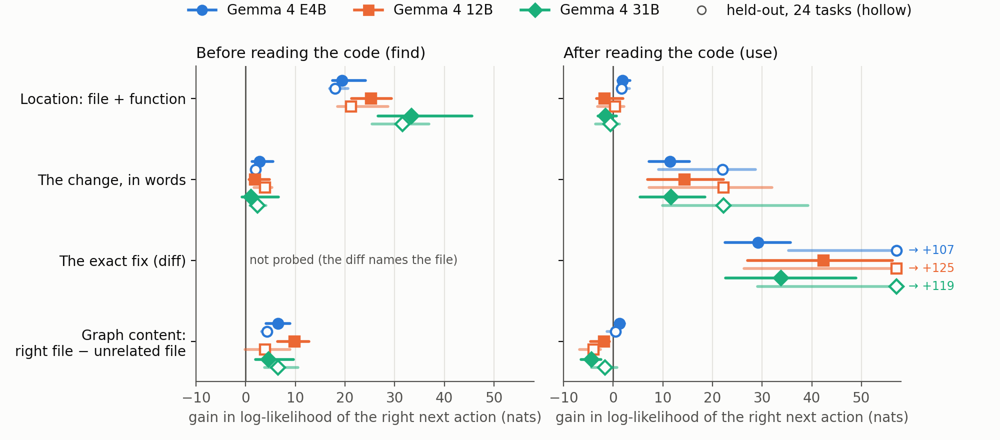
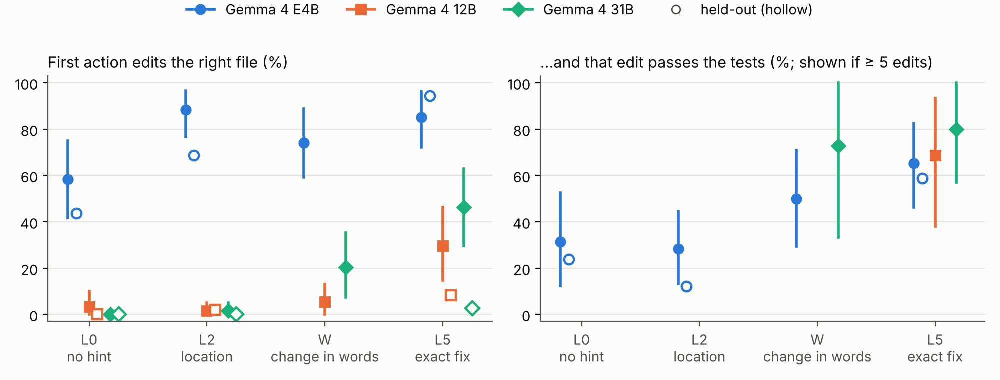
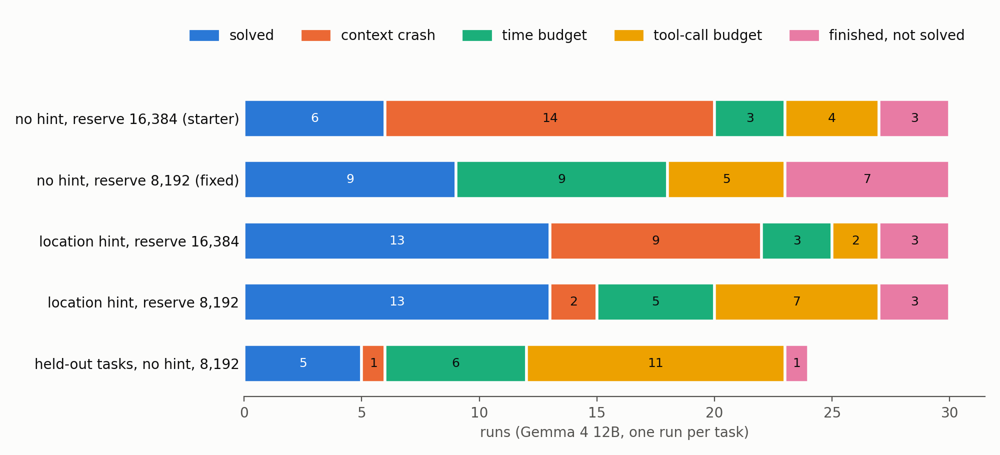

<!-- DRAFT: user rewrites. Every prose paragraph below is a draft for Mikel to say in his own words.
Every number maps to a row in research/claims.md. Held-out numbers come from results/D1_analysis.json,
results/D1v_analysis.json and results/D2_analysis.json on this branch.
Word count (title + abstract + body + captions + tables + references, HTML comments excluded): python paper/wordcount.py -->

# Lost or Clueless? Where a Gemma 4 Coding Agent Gets Stuck

**Freezing the agent mid-run to see which information changes its next move**

## Abstract

Coding agents built on small open models such as Gemma 4 still fail often, and the usual explanation is that they get lost in large codebases. We test this with a probe that freezes the agent at a real point of a run, adds one piece of information, and measures how much more likely its correct next action becomes. On 30 audited practice tasks and three Gemma 4 sizes, naming the file and function makes the correct first read 19–33 nats more likely. Once the code has been read, the same hint changes the correct edit by less than 2 nats, while a description of the change raises it by 11–14. A graph-tool output's content helps finding about as much as naming the file. The larger models edit far less often than E4B, and almost never on held-out tasks. Two harness problems, context-window crashes and a compaction step that deletes the task statement, distort end-to-end results, and one setting removes most crashes. The log-likelihood results replicate on 24 held-out tasks from three other projects.

## 1 Introduction

Coding agents that run on small open models, on hardware a developer already owns, would reach many more people. The Gemma 4 Developer Agent competition asks for such agents [1], and they still fail often. The model is not the only limit: one participant found that much stronger models, run through the same harness, solve only 4–5 more of 124 tasks than Gemma 4 31B [2].

The usual explanation is that small agents get lost in large codebases, so much effort goes into navigation aids such as code graphs, similarity search and repository maps. We test that assumption. An agent can be lost, not knowing where to look, or clueless, knowing where but not what to change, and the two need different fixes. Another participant came to a similar conclusion by reading run traces [3]; ours comes from controlled interventions.

We stop real runs at two moments, before the agent has read any code (find) and just after it has read the right code (use), and add information one rung at a time: the file, the function, the reproduction test, a description of the change, the exact fix. Length-matched wrong hints serve as controls. We probe three Gemma 4 sizes, check the results in real runs with real tests, and repeat the main conditions on 24 held-out tasks from three other projects, fixed after Gemma 4's release. Hypotheses were committed before the data.

Location helps the agent find the code but not fix it, for all three sizes, as pre-registered and on held-out tasks. The fix responds to a description of the change, and the larger models rarely edit as their next step. A graph output helps finding about as much as the file name does. The harness hides much of this. Long conversations crash it, as other participants also found [4, 5], and one setting mostly fixes that; its compaction step also erases the task statement.

We contribute the probe, these findings, a measured fix for the crashes, a per-task audit of the practice set and 101 valid held-out tasks.

## 2 Setting

**Harness.** We use the official sample agent (Google ADK) with its file, shell, graph and embedding-search tools, a budget of 40 tool calls or 15 minutes per task, and Gemma 4 QAT models served by vLLM in a 32,768-token window. A task counts as solved when its required tests pass with the agent's patch [1].

**Audit.** Before using the 129 practice tasks we ran each in the official Kaggle sandbox with the official fix and with no change. 71 are valid: the fix passes and the unchanged code fails (Table 1). Others had reported the 71 gold passes, the missing test modules, and that requests and httpx could not be tested because of their src layout [6]. Our audit adds a no-patch run and a cause for each invalid task. In all 14 requests and httpx tasks, the tests import the library installed on the host instead of the repository, so no patch can change the outcome.

*Table 1. Why 58 of 129 practice tasks are invalid in the official sandbox.*

| Cause | Tasks |
|---|---|
| test module missing from the image | 34 |
| tests import the host's installed library, not the repo | 14 |
| expected output depends on the environment | 5 |
| async test plugin missing | 2 |
| tests pass with no patch | 2 |
| required test skipped on Python 3.12 | 1 |

**Held-out tasks.** We mined fixes merged May–October 2026 in five projects outside the practice set (sqlglot, tomlkit, networkx, sympy, pyparsing). Of 114 tasks, 101 are valid in the Kaggle image. Graphs are built with codegraph-loc [15] under the released generator's rules, which reproduce the node ids of all 7 practice graphs; embeddings come from a disclosed open model, since the released one is not public. Probes and runs use 24 tasks whose statement is an issue rather than a pull-request description, which often gives the fix away (sqlglot 11, tomlkit 8, networkx 5). Sympy's graph is too large for the graph tools.

## 3 The probe

We run the real agent loop against a server that records every request and keep two states per task: find, after the task prompt and before any code is read, and use, right after the agent has read the gold function. We then add one hint (Table 2) and score the correct next action, which is reading the gold function's exact line span at find and making the gold edit at use. Its log-likelihood under each model's own chat template, with thinking off, is measured in nats. Bigger is better and the scale is logarithmic: +1 nat makes the action 2.7 times more likely, +20 nats about 500 million times. Unlike a solve rate, it does not sit at zero for small models.

*Table 2. Hints. L1–L5 are cumulative; the others are added alone. Wrong hints are length-matched.*

| Code | Added to the task |
|---|---|
| L1, L2 | the file; plus the function |
| L3, L4, L5 | plus the reproduction test; the change in words; the exact diff |
| W | the change in words only |
| G, G-null | graph-tool output around the gold function; around an unrelated file |
| X-file, X-func, X-graph | wrong file; wrong function; graph focused on a wrong function |

We also sample the actual next action with thinking on (once at find, twice at use), classify it, apply each sampled edit on its own and run the task's required tests. We report medians over tasks with bootstrap CIs and Wilcoxon tests, Holm-corrected. Rescoring the same cell moves it by a median 0.2–0.6 nats. We probe 30 valid practice tasks with Gemma 4 E4B, 12B and 31B, and run 12B end to end on them with no hint and with the file, function and test names. The plan was committed before any GPU run, and the held-out criteria before any held-out data existed.

## 4 Results

### 4.1 Where helps finding, not fixing

With the file and function named, the correct first read becomes 19.4, 25.3 and 33.4 nats more likely for E4B, 12B and 31B (Figure 1). After the code has been read, the same hint only confirms the place, and moves the correct edit by +1.9, −1.8 and −1.5 nats. The pre-registered find-versus-use test holds for each size (Holm p < 0.001). A wrong file costs 9–19 nats against the right one, while a wrong function in the right file still helps, because the file is right. The description of the change adds only 1–3 nats at find.

Held-out tasks give the same picture: +18.0, +21.2 and +31.5 nats at find, +1.7, +0.4 and −0.5 at use, and all four pre-registered criteria hold for all three sizes. On practice tasks the sampled first action follows the hint too, lifting reads of the gold function from 3–13% to 93–97%. On held-out tasks E4B always follows it, but 12B reads the gold file first in 13 of 24 tasks and 31B in 1, so a more likely read is not always the first move.

Of six pre-registered hypotheses, only find-versus-use held in full and three failed (scorecard: results/C03C04_tables.md). One was the link to real runs: the probe's per-task values did not predict which tasks the hint would rescue (AUC 0.43, and 0.27 once crashes were removed).

*Figure 1. Gain in log-likelihood of the correct next action (median, 95% CI): over no hint in the top three rows, right graph minus unrelated graph in the bottom row. Filled: 27–30 practice tasks; hollow: 18–24 held-out tasks, with off-scale values printed at the edge. Location helps before the code is read, the description of the change after.*

### 4.2 What to change matters more, and bigger models hesitate

At use, describing the change raises the correct edit by 11.4–14.4 nats on practice tasks and by about 22 on held-out tasks. The exact diff adds 29–42 and 107–125. The reproduction test adds 0.4–2.2 nats on practice tasks and 4–11 on held-out ones. Tests on sampled edits point the same way, weakly. On 27 paired practice tasks, E4B's edits pass in 20% of samples with no hint, 28% with the location and 37% with the description, 12B's in 4%, 2% and 6%, and 31B's in 0%, 2% and 15%; only E4B's description-versus-nothing difference survives correction (Holm p = 0.047). On held-out tasks E4B passes in 10%, 8% and, with the exact diff, 56% of samples.

The larger models fail differently from E4B (Figure 2). Right after reading the right code, 31B made no edit in 60 practice samples; it read more, ran a command or wrote a script. With the exact diff in its prompt it edited in 46% of samples, and 20 of those 25 edits passed. On held-out tasks it edited once in 132 samples, and its most common first move without a hint was writing a new file (19 of 48). E4B edits in 58–88% of practice samples and is often wrong. We grade by tests, since exact matching would miss 54 of E4B's 65 passing practice edits below L5.

Full runs show the same habit. In 24 held-out 12B runs the agent read files 442 times and ran 346 commands but called the edit tool 16 times (plus 15 file writes); 5 runs were solved and 17 ended on the time or tool-call budget.

*Figure 2. First sampled action right after reading the right code. Filled: practice tasks (95% CI); hollow: held-out tasks (L0, L2, L5 only). The larger models edit far less often than E4B, and almost never on held-out tasks. Right panel: passes among edits; the text counts all samples.*

### 4.3 Graphs help by naming the file

At find, a graph-tool output around the gold function beats the same kind of output for an unrelated file by 6.5, 9.8 and 4.6 nats (against no hint: +11.0, −1.6 and +7.4), close to what naming the file in text gives (6.3–8.2). Moving the graph's focus to a wrong function in the right file costs only 1.0–1.5 nats, against 11–20 for the same swap in text, because graph node ids are dotted module paths that name the file. A sentence naming the function beats every graph by 7–29 nats. At use, the unrelated graph does as well as the right one (+0.5, +9.3 and +8.7 nats against +1.2, +7.5 and +5.3), so the gain there comes from the extra tool turn itself. Held-out tasks agree: the right graph wins at find by 4.3, 3.9 and 6.5 nats, and the unrelated graph matches or beats it at use.

### 4.4 The harness hides much of this

**Crashes.** vLLM refuses a request when the prompt plus the space reserved for the answer exceeds 32,768 tokens. The starter reserves 16,384, and ADK compacts only after the previous prompt has passed 14,336 tokens, so one long tool output can overflow before compaction runs. Participants had described this [4, 5]; we traced it ourselves in the vLLM and ADK source while working out why our runs crashed. In our first 12B runs, 14 of 30 no-hint and 9 of 30 hinted runs crashed this way, and all 7 tasks the hint seemed to rescue had crashed without it. With the reserve lowered to 8,192 (Figure 3), crashes fell from 14 to 0 without the hint (McNemar p = 0.0001) and from 9 to 2 with it, no-hint solves rose from 6 to 9, and the hint's advantage fell from 7 tasks to 4 (p = 0.29). One of the 24 held-out runs crashed, within the pre-registered limit.

**Compaction.** Around the tenth tool call, ADK replaces older history with a summary written by the model. The summarizer only reads text, so tool calls and their outputs are dropped, as another participant also found [7]. In all 137 compacted runs (113 practice, 24 held-out) the task prompt was among the summarized events. In the 82 runs where we checked every later request, none of 2,054 contained the original statement. The median summary kept 0–1% of the statement's five-word phrases and about a third of its words. The agent then seems to edit from memory: once practice runs stopped crashing, failed edits rose from 6 to 33 (33 of 52 edits in the 8 runs with failures; 15 in one run). Of these, 32 tried to replace text that had never been in the file and 31 came after the first compaction. Held-out runs edited too rarely to say more (3 of 16 edits failed, all after compaction).

*Figure 3. How 12B runs ended, with the output reserve at 16,384 and at 8,192 tokens (30 practice tasks; 24 held-out). "Finished, not solved": the run ended within budget but its patch failed the tests. With crashes gone, the hint's advantage shrinks from 7 tasks to 4.*

## 5 Related work

Localization is often treated as the bottleneck. Oracle retrieval in SWE-bench [8], hierarchical localization in Agentless [9] and graph-guided agents such as LocAgent [10] all help. Gold files raise resolve rates on SWE-bench Verified from 44.7% to 52.4% [11], and in a fixed repair pipeline file-level context dominates while line-level context often hurts [12]. In those pipelines the file is handed to a model that cannot search, so it stands in for the finding step. Closest to our thesis, a participant who read the traces of two practice runs found that the agent often named a file the fix touches but never edited it, and that an edit deadline mostly produced wrong edits [3]. Our probe separates finding from fixing: location matters when the agent looks for code, much less once it has read it. Repository graphs report gains [10, 13], and participants have audited the competition's graphs and embeddings [14] and rebuilt its generator [15]. We add a controlled test of what a graph's content does to the next decision. For context management, SWE-agent keeps the task while trimming old observations [16], and simple masking matches LLM summarization [17]; the summarizer here drops both the task and the tool outputs. Several of our observations appeared first in forum posts [3–7], which we cite for priority; every number in Section 4 comes from our own runs.

## 6 Limitations

Each condition is a single run, and full runs are noisy (15% of tasks flip between identical passes [2]), so part of the change from 6 to 9 solves may be chance. The practice tasks come from two projects (fastapi, rich) and the held-out tasks from three, and the description rung exists for only 18 of the 24 held-out tasks. The graph condition is one synthetic tool turn, not a multi-step exploration. The descriptions of the change were written by 31B from the gold diff. Held-out embeddings are a substitute.

## 7 Takeaways for builders

Concretely: give the agent a description of the change where one can be had, keep the task statement and the code it has read through compaction (masking old tool outputs instead of summarizing them does this), and set the output reserve so prompts fit. An edit deadline alone mostly produces wrong edits [3]; pushing for edits helps once the agent knows the change.

**Reproducibility.** Code, notebooks, frozen plans, analysis scripts and the figure script: https://github.com/abastosmikel-bit/gemma4-agent-paper. Held-out tasks are rebuilt from public GitHub by script. No competition data is redistributed.

**AI assistance.** Experiment code and analyses were written with Claude Code; the text was drafted with AI assistance and reviewed by the author.

## References

[1] Kaggle. Google – The Gemma 4 Developer Agent, competition pages, 2026.
[2] R. Zhu. Stronger models barely beat Gemma 4 31B in this harness. Kaggle forum 747168, 2026.
[3] kimdonggyu1255. Found, not fixed. Kaggle forum 749198, 2026.
[4] Ruihuan. Compact and retry on context-window overflow? Kaggle forum 747791, 2026.
[5] A. Wright. Compaction can't trigger at token_threshold 32,768. Kaggle forum 744692, 2026.
[6] O. Zhukov (comment in 744370); yesterdays_rebel (comment in 742882); babycare (745775). Sandbox validity reports. Kaggle forum, 2026.
[7] Whisper Last. Let submissions set the compaction summary prompt. Kaggle forum 747186, 2026.
[8] C. Jimenez et al. SWE-bench. ICLR 2024.
[9] C. Xia et al. Agentless. FSE 2025.
[10] Z. Chen et al. LocAgent. arXiv 2503.09089, 2025.
[11] M. N. Al Awad, S. Ivanov. Loc2Repair. arXiv 2606.30963, 2026.
[12] M. Sepidband, H. V. Pham, H. Hemmati. On the role of fault localization context for LLM-based program repair. arXiv 2604.05481, 2026.
[13] S. Ouyang et al. RepoGraph. ICLR 2025.
[14] J. Wold; A. Chinta; T. Singhal. Graph and embedding audits. Kaggle forum 742911, 745731, 744040, 2026.
[15] D. Mantiglia. codegraph-loc. github.com/danielmantiglia/codegraph-loc, 2026.
[16] J. Yang et al. SWE-agent. NeurIPS 2024.
[17] T. Lindenbauer et al. The Complexity Trap. arXiv 2508.21433, 2025.
